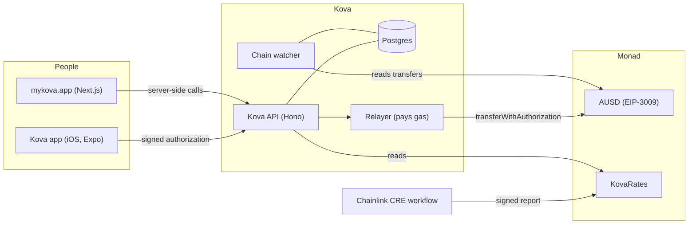

# Kova

**Tap. Paid. Anywhere.** A dollar wallet you open with a passkey, with your shop inside it.
Every payment settles in AUSD on [Monad](https://monad.xyz) in about a second and a half, and Kova
pays the gas, so nobody needs a crypto token, a seed phrase or an exchange to pay or get paid.

- **Live on Monad mainnet:** [mykova.app](https://mykova.app)
- **Try it free:** [web-monad.up.railway.app](https://web-monad.up.railway.app), Kova on Monad testnet with $5 of test dollars a day
- **Built for:** Monad Metropolis, Track 02: Consumer Products & Payments
- **Demo video:** _link added at submission_
- **Licence:** [MIT](LICENSE)

## The problem, and who it's for

Moving dollars across a border, or taking a payment at a small shop, is still slow, expensive or
both. Stablecoins fix the money, but not the experience: people are asked to buy a gas token,
guard a seed phrase and copy long addresses. Most never get past that.

Kova is for people who don't think of themselves as crypto users: someone paying for coffee,
sending $20 to a friend abroad, or running a bakery that wants to take payments on a phone. They
see dollars, their own currency beside them, and Face ID. Nothing else.

## What it does

- **Wallet.** Create it with Face ID. The passkey is the wallet: its key is derived from the
  passkey (WebAuthn PRF), so there's no seed phrase, and the same passkey opens the same wallet in
  the iOS app and at mykova.app.
- **Pay.** Scan a code or open a pay link, approve with Face ID, and it's paid. Measured from
  Lagos: about a second from tap to paid (0.91 to 1.05 s), with a fee of $0.00.
- **Send, in one sheet.** Who, how much (with what they'll see in their own currency), a look at
  the route, slide to send, and the same sheet becomes the receipt with the measured time, while
  the balance behind it counts down. The same on the web. $20 arrives as ≈ €18.40.
- **Send by link, to anyone.** Pick an amount, share a link on WhatsApp. The friend abroad needs no
  wallet and no app: the link shows "Ada sent you $20.00, about €18.40", and they claim it with
  Face ID or with their email or Google (Privy), in under a second. The dollars wait at a one-time
  address whose key lives only in the link (after the `#`, so it never reaches a server); an
  unclaimed link can be taken back.
- **Private notes.** "For dinner" travels with the payment, sealed on the sender's device for the
  receiver and the sender (X25519, XChaCha20-Poly1305, keys derived from each passkey and signed
  by each wallet). Kova stores ciphertext it can't read.
- **From guest to Kova.** Someone who paid a shop with email or Google can keep their change: one
  passkey makes a Kova wallet, and the email wallet moves what's left into it, gas-free.
- **From another chain.** Each wallet gets permanent deposit addresses (EVM chains, Solana, Tron,
  Bitcoin) through Aurora Intents (NEAR Intents); USDC, USDT, ETH, SOL or BTC sent there arrives as
  dollars on Monad. Built; it opens with Kova's move to mainnet, where Intents has its liquidity.
- **Your shop, inside the wallet.** Open a shop from your wallet; its sales land in the same wallet.
  A stall page to share, a catalogue, a till (the phone becomes a terminal: keypad, items or
  barcode scanner, then a QR code for the customer), orders, and the day's takings, live.
- **Order from the table, and a stamp card.** Each table has its own code; the order arrives as
  "Table 3", and when the shop taps Ready the customer's phone says so: no queue, no buzzer. A
  shop can turn on a stamp card with no sign-up (the wallet that pays is the card): after five
  paid orders the cheapest item on the next is free, and even that $0.00 order has a receipt on
  Monad.
- **Private takings.** On a public chain anyone can add up a shop's sales. With private takings on,
  each sale is paid to a fresh one-time address that only the shop can find and open (ERC-5564
  stealth addresses), so nobody can. The shop moves its takings to its wallet in one tap, gas-free,
  and can give its accountant a view link that sees every sale and can move none.
- **Private sends, and spending them privately.** Turn on "Send privately" and the dollars go to a
  fresh one-time address only the recipient can find: Monad shows who sent how much, but not to
  whom. The sender's name and note travel sealed inside the payment, for the recipient's viewing key
  alone, so their phone never asks anyone who paid. Private dollars are spent straight from those
  addresses (pay a shop, or send privately again) without ever passing through the recipient's
  wallet; when one address doesn't cover it, several are gathered into one new address first.
- **One account.** Shop owners sign in on the web with the same wallet (Sign-In with Ethereum,
  EIP-4361): no passwords, no API keys. Customers without Kova can pay a checkout with email or
  Google (Privy).
- **Test dollars.** On testnet, every wallet gets $5 of test AUSD a day.
- **Also in the app:** Kova Travel (flights and hotels, paid in dollars, with refunds), "Snap your
  menu" (a photo of a menu becomes catalogue items), and spending insights.

## How Kova uses Monad

- **Payments are signatures.** The payer signs an EIP-3009 `transferWithAuthorization` for AUSD;
  Kova's relayer submits it on Monad and pays the gas. Payers never hold MON.
- **One round-trip to paid.** The relayer estimates gas alongside fees and a locally counted
  nonce, signs locally and sends with `eth_sendRawTransactionSync`, so the receipt comes back with
  the send: about 0.4 to 0.5 s on the server, about a second from a phone in Lagos.
- **Why Monad.** Blocks and finality fast enough for a checkout line (about 1.5 s from tap to paid
  on real receipts), and gas cheap enough for Kova to pay it for every user, which is what makes a
  consumer product with no gas token possible. Monad charges for the gas limit a transaction asks
  for, so the relayer estimates each payment and caps it (`KOVA_MAX_RELAY_GAS`).
- **Charges carry their reference on-chain.** A checkout's reference rides in the authorization's
  nonce, so Kova's chain watcher settles a payment no matter who submits it (another relayer, or
  the payer's own wallet), and indexes transfers for wallets.
- **Exchange rates from Chainlink.** A Chainlink CRE workflow ([apps/rates](apps/rates)) fetches
  two independent FX sources, drops any currency where they disagree by more than 2%, reaches
  consensus across nodes, and writes a signed report to the `KovaRates` contract on Monad. Kova's
  API reads the contract, and the app and web label every local price "Chainlink rate from 3 min
  ago". Reports are published with the CRE CLI (`cre workflow simulate --broadcast`) until the
  workflow is deployed to a DON.

- **Privacy on a public chain, by permission.** Private takings and private sends follow the idea of
  Monad's Private Settlement design (private by default, visible only to whom you allow) with what
  Monad runs today: ERC-5564 stealth addresses, scheme 1
  ([packages/monad/src/stealth.ts](packages/monad/src/stealth.ts)).
  - Each wallet's private-receiving keys come from its own passkey, and its public half is signed by
    the wallet, so a sender checks Kova never swapped it. Kova never holds a key that can move the
    dollars.
  - Every private payment is posted to ERC-5564's announcer on Monad
    ([apps/api/src/workers/announcer.ts](apps/api/src/workers/announcer.ts)): it is on mainnet, and
    Kova deployed it on testnet at the same canonical address. Any wallet can find its payments from
    the chain alone, without Kova.
  - The announcement's metadata carries the sender's memo (who, their name, a note), sealed
    (XChaCha20-Poly1305) with a key from the payment's own shared secret, so only the recipient's
    viewing key opens it. A sender spending private dollars proves it's them with their wallet's
    signature inside the memo.
  - Spending straight from one-time addresses means private dollars never have to pass through
    your wallet.
  - What stays public: the amount, and anything moved into a wallet. Gathering several addresses
    links them to each other, not to you.
  - Monad's fees are what make a fresh address per payment, and a transaction to spend each one,
    affordable by default. When Private Settlement ships, a shop's books can move into its own
    encrypted domain.
  - `pnpm --filter @kova/api check:private` runs it all for real on testnet.

### On-chain (Monad testnet, chain 10143)

| What | Address or transaction |
|---|---|
| AUSD (Agora), the token every payment moves | [`0xa9012a055bd4e0eDfF8Ce09f960291C09D5322dC`](https://testnet.monadscan.com/address/0xa9012a055bd4e0eDfF8Ce09f960291C09D5322dC) |
| Kova's relayer, which pays everyone's gas | [`0x5868C3C3D1316AF8a78D2e47ee9F385272771940`](https://testnet.monadscan.com/address/0x5868C3C3D1316AF8a78D2e47ee9F385272771940) |
| A coffee, $4.50, paid in 1.6 s with a $0.00 fee | [`0x6a52a3cf…eda34e005`](https://testnet.monadscan.com/tx/0x6a52a3cfc7ecdf6400d7d09888e6ef2cf06bd38c2121619a5007d62eda34e005) |
| $20 to a friend, arriving as ≈ €18.40 | [`0xa92a1733…6b61e0437`](https://testnet.monadscan.com/tx/0xa92a17331a4804556b08779949819220b56aef075c7ada8b5e4c3136b61e0437) |
| KovaRates, written by Chainlink CRE | [`0xb5322DC6d6AA938C50859f0f0e2DF7b6Da4C9e8e`](https://testnet.monadscan.com/address/0xb5322DC6d6AA938C50859f0f0e2DF7b6Da4C9e8e) |
| A Chainlink rate report: NGN 1,328.02, KES 129.03, EUR 0.8855, GBP 0.7560, MXN 18.184 | [`0x982e9045…c4fc7694`](https://testnet.monadscan.com/tx/0x982e904589b29fd3a76d0773bb66aa9346eb49ecfaa8faa7f59b4e09c4fc7694) |
| A bakery sale, $6.50, at a Kova till | [`0x152be347…f1e151265`](https://testnet.monadscan.com/tx/0x152be347b25c3b89a1e70607d7e8d3cb3cd1721adcc3931ac31e784e1f151265) |
| A send from the one-sheet flow at mykova.app, $2.50 | [`0x3306403e…e6a28ad792`](https://testnet.monadscan.com/tx/0x3306403ec1917c92f39300ab65e85f820101751fc581cc716f04e1e6a28ad792) |
| $1.00 with a private note ("Puff-puff for the road"), web to phone | [`0xc3645812…e4fd0e05810`](https://testnet.monadscan.com/tx/0xc3645812e47ed594be7ae0d5a8f9f2913688ce3940890ed638045e4fd0e05810) |
| $0.50 with a private note back ("Thanks Ada!"), phone to web | [`0x3d43cd4d…b33f5c11`](https://testnet.monadscan.com/tx/0x3d43cd4d445795446a3ab3468cdef0d63711478b95f3afc06146283ab33f5c11) |
| Ordered and paid from table 3, $7.75 in 0.76 s | [`0x61749899…e5a16f2`](https://testnet.monadscan.com/tx/0x617498997c9c5d23163ded2e4d522c6e48918b3f491ebd919469a9515e5a16f2) |
| The sixth croissant, free with the stamp card: a $0.00 payment with its receipt | [`0x73001c6d…6dcdec0`](https://testnet.monadscan.com/tx/0x73001c6d1dd2d91ec4fd7be01d3c014658b64200a3979f1e206dd8e5ae5cdec0) |
| $20 sent by link and claimed by a brand-new wallet in 0.7 s | [`0x7feaee54…2534574`](https://testnet.monadscan.com/tx/0x7feaee5485ac02397b29cf04be0735dee24b10514179fe01d7a463ecb2534574) |
| ERC-5564's announcer, deployed by Kova at its canonical address (as on mainnet) | [`0x6438a00e…77be1`](https://testnet.monadscan.com/tx/0x6438a00eb136c8f7b241b15dcce2d4720131b2789a13cd571adaa779c7b77be1) |
| A private send's Announcement on Monad, with its sealed memo in the metadata | [`0x62b66ba6…9069992`](https://testnet.monadscan.com/tx/0x62b66ba678e6373fb963a95e6acd7993c1f7a9237dcf192a22facda913069992) |
| Paid straight from a one-time address, the change left there | [`0x969774c6…3b1e4a2`](https://testnet.monadscan.com/tx/0x969774c69680a48df7b2681087ba4af971e09394ed7fd625f5fd08cc03b1e4a2) |
| Two private payments gathered into one new address, then spent from it | [`0x240552b3…290081d`](https://testnet.monadscan.com/tx/0x240552b39b6156883a32cb82f836be137e2d2f9223ed7e796d6fe2699290081d), [`0xcfdc9845…a06a85b`](https://testnet.monadscan.com/tx/0xcfdc9845ef1f87442a949615541c51b08dcc8473778bf6581c3125f0af06a85b) |

### On-chain (Monad mainnet, chain 143)

| What | Address |
|---|---|
| AUSD (Agora) | [`0x00000000eFE302BEAA2b3e6e1b18d08D69a9012a`](https://monadscan.com/address/0x00000000eFE302BEAA2b3e6e1b18d08D69a9012a) |
| Kova's relayer | [`0x67d185427d896aaf1d8781E094f1Bad16f7fa967`](https://monadscan.com/address/0x67d185427d896aaf1d8781E094f1Bad16f7fa967) |
| KovaCard, the Kova Card's contract | [`0x9bee9F2D59d9675F2723B274e1276F5931Ef325E`](https://monadscan.com/address/0x9bee9F2D59d9675F2723B274e1276F5931Ef325E) |
| ERC-5564 announcer and ERC-6538 registry (standard; Kova posts every private payment to the announcer) | [`0x55649E01…5564`](https://monadscan.com/address/0x55649E01B5Df198D18D95b5cc5051630cfD45564), [`0x6538E6bf…6538`](https://monadscan.com/address/0x6538E6bf4B0eBd30A8Ea093027Ac2422ce5d6538) |

## Architecture



| Path | What it is |
|---|---|
| [`apps/mobile`](apps/mobile) | The Kova app (Expo, React Native): the wallet, and shop mode with the till. Installs with npm, outside the pnpm workspace. |
| [`apps/web`](apps/web) | mykova.app (Next.js): landing, the web wallet (`/wallet`), shop mode (`/dashboard`), pay pages (`/pay/:id`), stall pages (`/s/:slug`) and request links (`/to/:address`). Every API call is made server-side. |
| [`apps/api`](apps/api) | The Kova API (Hono on Node): payment intents and checkout, relaying signed payments, the chain watcher, wallets (transfers, encrypted vaults, test dollars), wallet sign-in, shops, stalls, catalogue, tills, travel. |
| [`apps/rates`](apps/rates) | The Chainlink CRE workflow and the `KovaRates` contract (Foundry). |
| [`packages/monad`](packages/monad) | Networks, tokens (AUSD, USDC), EIP-3009 helpers and the on-chain memo. |
| [`packages/db`](packages/db) | Postgres schema and migrations (Drizzle). |
| [`packages/tempo`](packages/tempo) | From the earlier Tempo build (see below); the Monad build doesn't use it. |
| [`film`](film) | The launch teaser and link preview, rendered with Remotion. |
| [`docs`](docs) | Design notes, research, and [the Metropolis checklist](docs/metropolis.md). |

## Tech stack

TypeScript throughout · Monad testnet · [viem](https://viem.sh) · AUSD by
[Agora](https://agora.finance) · passkey wallets with [Mera](https://www.npmjs.com/package/@category-labs/mera)
(WebAuthn PRF) · [Hono](https://hono.dev) on Node 22 · PostgreSQL with
[Drizzle](https://orm.drizzle.team) · [Next.js](https://nextjs.org) 16 and React 19 ·
[Expo](https://expo.dev) SDK 54 (React Native) · [Privy](https://privy.io) · Chainlink CRE ·
[Foundry](https://getfoundry.sh) · [Railway](https://railway.com) · Vitest · Biome ·
[Remotion](https://www.remotion.dev) and [ElevenLabs](https://elevenlabs.io) for the film.

## Run it

You need Node 22.12+, pnpm 10, PostgreSQL 16, and Xcode for the iOS app.

```bash
git clone https://github.com/Cybire1/kova && cd kova
git checkout monad
pnpm install
```

**API** (http://localhost:4000; migrations run on start):

```bash
cp apps/api/.env.example apps/api/.env
createdb kova_dev
pnpm --filter @kova/api setup:dev   # 1st run: generates a relayer key into apps/api/.env.monad
# fund that relayer with testnet MON at https://faucet.monad.xyz, then:
pnpm --filter @kova/api setup:dev   # 2nd run: creates a demo shop and prints its API key
pnpm --filter @kova/api dev
```

Test dollars and payments need test AUSD in the relayer. Agora's testnet faucet
(`0xd236c18D274E54FAccC3dd9DDA4b27965a73ee6C`) gives 10,000 per address when it has funds; when
it's empty, send test AUSD to the relayer's address.

**Web** (http://localhost:3000):

```bash
cp apps/web/.env.example apps/web/.env.local   # KOVA_API_URL=http://localhost:4000, a SESSION_SECRET
pnpm --filter @kova/web dev
```

**iOS app:**

```bash
cd apps/mobile
npm install
cp .env.example .env   # EXPO_PUBLIC_KOVA_MONAD_API_URL=http://<your Mac's LAN IP>:4000 on a phone
npx expo run:ios
```

**Tests:** `pnpm --filter @kova/api test` runs the API suite against your local Postgres; the
end-to-end payment tests also need a relayer with MON and test AUSD.

**Deploy:** the API and web app ship as Docker images ([Dockerfile](Dockerfile),
[Dockerfile.web](Dockerfile.web)) on Railway, with the same variables as the `.env.example` files.
In production the relayer key belongs in a KMS.

## Built during Metropolis, on an earlier Tempo foundation

All of Kova was written during the Metropolis build window (1 September to 13 October 2026). It
began on 19 September as a Tempo build for Colosseum's Crypto World's Fair (branch `main`, until
23 September): the API's foundation, the database schema, payment intents, the merchant dashboard
and the first app screens. The Monad build (branch `monad`) moved Kova to Monad and added, among
other things: payments by signature with sponsored gas on Monad, the chain watcher, passkey wallets
with Mera and encrypted vaults, the web wallet, the shop inside the wallet, wallet sign-in
(EIP-4361), email and Google with Privy, the Chainlink CRE rates workflow, stalls, tills and
catalogue, Kova Travel, test dollars, and the launch film.

## AI disclosure

Kova was built with AI coding tools. Most of the code, tests and documentation, and the film's
code, were written with [Claude Code](https://claude.com/claude-code) (Anthropic's Claude models)
under the team's direction and review. The film's voiceover was generated with ElevenLabs. At
runtime, two optional features call AI models: "Snap your menu" (Claude or DeepSeek) and spending
insights (TypeSafe's Jev).

## Attribution

Kova builds on open-source software, each under its own licence, including:
[viem](https://github.com/wevm/viem), [Mera](https://www.npmjs.com/package/@category-labs/mera),
[@noble](https://github.com/paulmillr/noble-hashes) and [@scure](https://github.com/paulmillr/scure-bip39)
cryptography, [Hono](https://github.com/honojs/hono), [Drizzle ORM](https://github.com/drizzle-team/drizzle-orm),
[Zod](https://github.com/colinhacks/zod), [Next.js](https://github.com/vercel/next.js),
[React](https://github.com/facebook/react), [Expo](https://github.com/expo/expo) and
[React Native](https://github.com/facebook/react-native), the [Privy](https://www.npmjs.com/package/@privy-io/react-auth)
SDK, the [Chainlink CRE](https://docs.chain.link/cre) SDK, [Foundry](https://github.com/foundry-rs/foundry),
[Remotion](https://github.com/remotion-dev/remotion) (Remotion licence), [Vitest](https://github.com/vitest-dev/vitest)
and [Biome](https://github.com/biomejs/biome). The [Manrope](https://fonts.google.com/specimen/Manrope)
typeface is under the SIL Open Font License. AUSD is Agora's; exchange-rate sources are
[open.er-api.com](https://open.er-api.com) and the [fawazahmed0 currency API](https://github.com/fawazahmed0/exchange-api).
