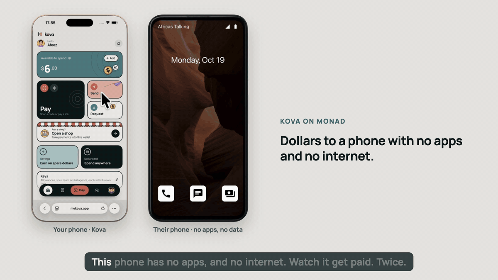
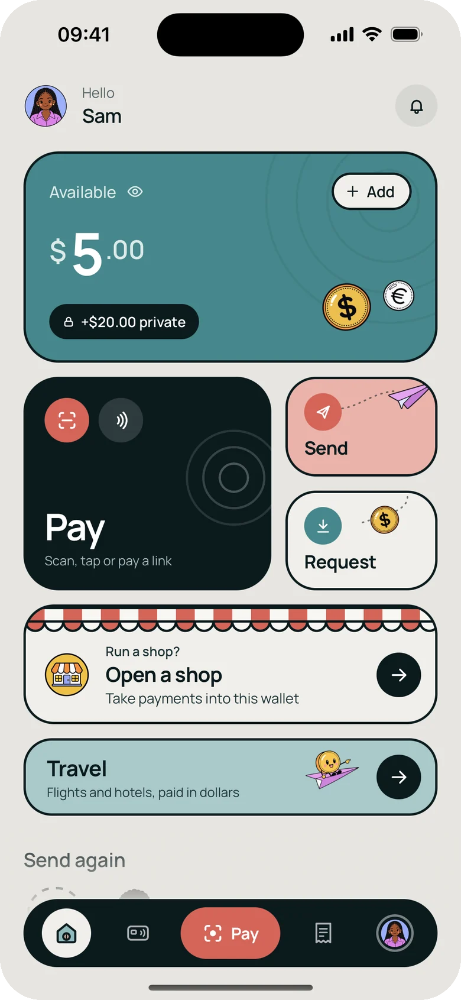
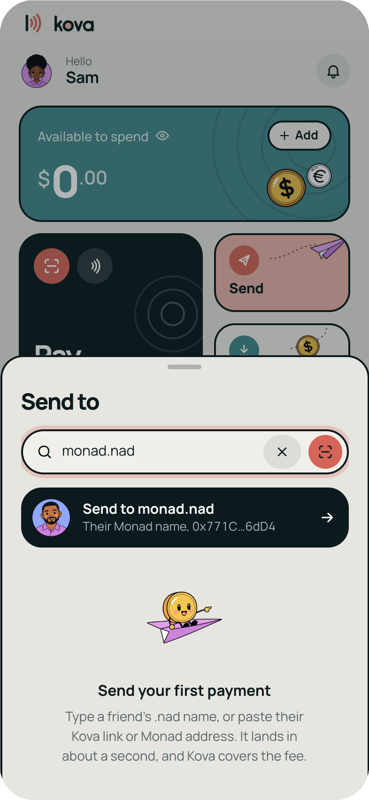
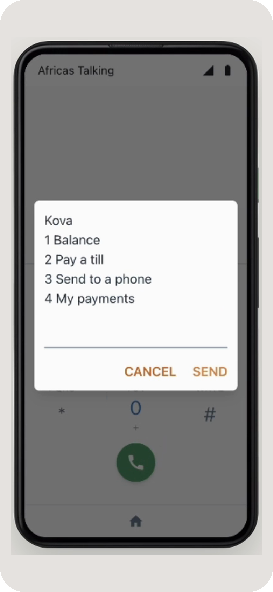
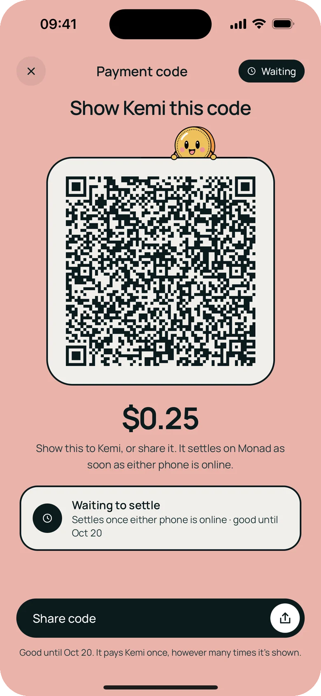
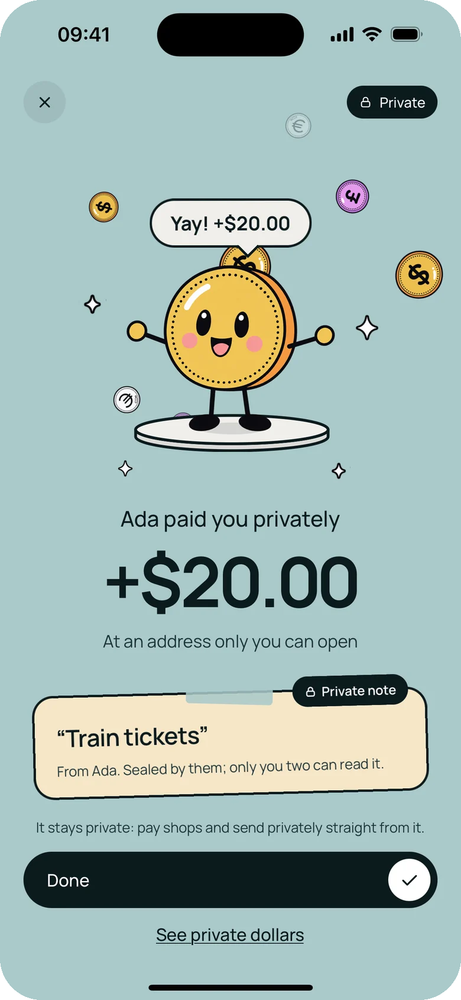
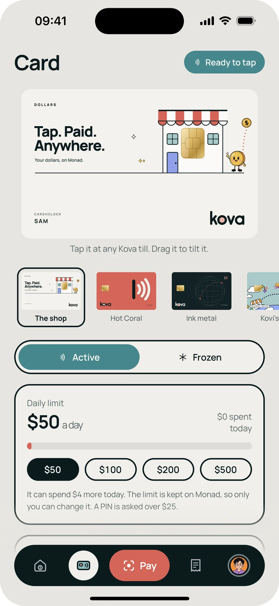
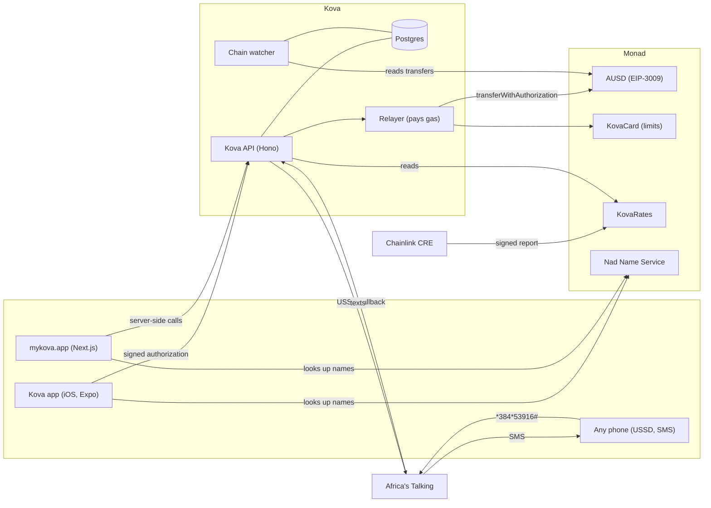

<p align="center">
  
</p>

<p align="center">
  <b>Dollars for every phone.</b><br>
  A dollar account you open with Face ID. Pay a shop, send to a friend abroad, or pay a phone<br>
  with no apps and no internet. Every payment settles on <a href="https://monad.xyz">Monad</a> in about a second, and Kova pays the fee.
</p>

<p align="center">
  <a href="https://mykova.app/wallet"><b>Try it at mykova.app</b></a> ·
  <a href="https://testflight.apple.com/join/RPEhxUWv">iOS on TestFlight</a> ·
  <a href="AGENTS.md">For reviewers</a> ·
  <a href="https://github.com/Cybire1/kova/actions/workflows/ci.yml"></a>
</p>

<p align="center">
  
  <br>
  <sub>A real run on Monad testnet: a Kova wallet pays a phone number, the phone gets a text, then dials Kova's USSD code (on Africa's Talking's simulator).</sub>
</p>

## The problem

You live in London. Your grandmother lives in a village back home. She has a basic phone, no
smartphone and no data. Sending her $50 today means agent fees, slow transfers, and a currency
that loses value while it waits.

Stablecoins fixed the money, but not the experience. They still ask for an app, internet, a gas
token, a seed phrase and a long address. Hundreds of millions of people have a phone but no
internet, and most people never get past the seed phrase.

**With Kova, you send dollars to her phone number. She gets a text. She dials a short code, enters
her PIN, and checks or spends her dollars, with no app and no internet.** You set her up once from
your Kova app: her number, a PIN, a daily limit, and a code Kova texts to her phone.

We believe that if you solve a real problem, people use the product. This is the one we chose.

## What it does

<table>
  <tr>
    <td width="33%" valign="top">
      <br>
      <b>Pay in about a second</b><br>
      Scan a code or tap a till, approve with Face ID, paid. The fee is $0.00: Kova pays the gas.
      The passkey is the wallet, so there's no seed phrase.
    </td>
    <td width="33%" valign="top">
      <br>
      <b>Send to a phone number or a .nad name</b><br>
      Type <code>+234…</code>, <code>ada.nad</code> or just <code>ada</code>. Kova finds who it is,
      shows the address, and the money lands in about a second. Or send a link to anyone.
    </td>
    <td width="33%" valign="top">
      <br>
      <b>Dollars on any phone</b><br>
      No app, no data: a text when dollars arrive, then <code>*384*53916#</code> and a PIN to check
      the balance, pay a till or send to another phone.
    </td>
  </tr>
  <tr>
    <td width="33%" valign="top">
      <br>
      <b>Pay with no signal</b><br>
      In a market or a basement, Face ID signs the payment on the phone and it travels as a code.
      Whichever phone gets signal first settles it on Monad.
    </td>
    <td width="33%" valign="top">
      <br>
      <b>Private payments</b><br>
      Turn on "Send privately" and the dollars go to a one-time address only the recipient can
      open. The name and note travel sealed, for them alone.
    </td>
    <td width="33%" valign="top">
      <br>
      <b>Limits for cards, people and AI agents</b><br>
      Every card, teammate or AI agent that spends from your account gets its own key and daily
      limit, kept in a contract on Monad. Claude can pay over MCP, within its limit.
    </td>
  </tr>
</table>

<details>
<summary><b>More in Kova</b></summary>

- **Send by link, to anyone.** Share a link on WhatsApp: "Ada sent you $20.00, about €18.40".
  The friend claims it with Face ID, or with email or Google (Privy), in under a second. The key
  lives only in the link (after the `#`), and an unclaimed link can be taken back.
- **Their own currency.** Amounts show in naira, euros, pounds and more, beside the dollars.
- **Private notes.** "For dinner" travels with the payment, sealed on the sender's phone for the
  two of them (X25519, XChaCha20-Poly1305). Kova stores text it can't read.
- **A shop inside the wallet.** A stall page, a catalogue, a till (the phone becomes a terminal),
  orders from the table, a stamp card with no sign-up, and the day's takings live. Private
  takings pay each sale to a one-time address, so nobody can add up a shop's sales.
- **Kova for Business.** Private payroll and supplier payments, each checked on Monad.
- **Deposits from other chains.** MON on Monad and tokens from other networks convert into dollars
  through Relay. See [setup and verification](docs/multichain-deposits.md).
- **Naira in and out.** Add money in naira and cash out to a Nigerian bank through Paystack
  (test mode on testnet).
- **From guest to Kova.** Someone who paid a shop with email or Google can keep their change in a
  new Kova wallet, gas-free.
- **Also:** Kova Travel (flights and hotels in dollars), "Snap your menu" (a photo becomes catalogue
  items), and spending insights. A US account number, a dollar card and savings are built behind
  partner keys and show "Request access" until a partner switches them on.

</details>

## How it works for a phone with no internet

```
 your Kova wallet ──signs──▶ Kova API ──relayer pays gas──▶ Monad: AUSD lands in her pocket
                                │
 her phone ◀── text: "$1.00 arrived. Balance $9.25. Dial *384*53916#"   (Africa's Talking SMS)
 her phone ──dials *384*53916#──▶ Africa's Talking ──▶ Kova API: balance, pay a till, send
```

- Each phone number gets a **pocket**: its own address on Monad, holding AUSD, with a PIN and a
  daily limit (at most $200). The pocket's key is sealed on Kova's server (AES-256-GCM), the PIN is
  hashed (scrypt), and three wrong PINs lock it for 15 minutes.
- The wallet that set the pocket up can always take the dollars back, with no PIN, even if USSD
  is paused.
- A spend is signed from the pocket as an EIP-3009 authorization and relayed like any other Kova
  payment. Each USSD session pays once, however many times the network resends a screen.
- Sending to a number Kova doesn't know holds the dollars at a one-time address, texts an invite,
  and lets the sender take them back until they're claimed.
- Code: [`ussd.ts`](apps/api/src/services/ussd.ts), [`pockets.ts`](apps/api/src/services/pockets.ts),
  [`phone-payments.ts`](apps/api/src/services/phone-payments.ts),
  [`arrival-sms.ts`](apps/api/src/services/arrival-sms.ts).

Today this runs on Africa's Talking's simulator with test dollars. **Next:** a live USSD code per
country, and cashing out to mobile money (M-Pesa, MTN MoMo) from the same menu.

## How Kova uses Monad

- **Payments are signatures.** The payer signs an EIP-3009 `transferWithAuthorization` for AUSD.
  Kova's relayer submits it and pays the gas, so nobody holds MON.
- **One round-trip to paid.** The relayer estimates gas, counts its nonce locally, signs and sends
  with `eth_sendRawTransactionSync`, so the receipt comes back with the send: about 0.4 to 0.5 s on
  the server, about a second from tap to paid on a phone in Lagos.
- **Why Monad.** Finality fast enough for a checkout line, and gas cheap enough for Kova to pay it
  for every user. That's what makes a dollar app with no gas token possible. It also makes privacy
  affordable: a fresh address for every private payment, and a transaction to spend each one.
- **Charges carry their reference on-chain.** A checkout's reference rides in the authorization's
  nonce, so Kova's chain watcher settles a payment whoever submits it.
- **Limits live on Monad.** `KovaCard` holds each spending key's daily limit, freeze and cosigner,
  so the limit is kept by the contract, not by Kova's database.
- **Names on Monad.** `ada.nad` comes from Nad Name Service on Monad mainnet. A pasted address
  shows its own .nad name only when that name points back to it.
- **Privacy by permission.** Private payments use ERC-5564 stealth addresses
  ([`stealth.ts`](packages/monad/src/stealth.ts)), each posted to the standard announcer so any
  wallet can find its payments from the chain alone. The sender's memo is sealed for the
  recipient's viewing key. The amount is public; who it went to isn't.
- **Exchange rates from Chainlink CRE.** A workflow ([`apps/rates`](apps/rates)) checks two FX
  sources against each other, reaches consensus and writes a signed report to `KovaRates` on Monad
  testnet. Mainnet uses a fixed reference table, labelled as such.

## Proof on Monad

Kova's API, relayer and contracts are live on mainnet. This week mykova.app runs the testnet
build, with free test dollars, for the phone-payment demo.

### Mainnet (chain 143)

| What | Link |
|---|---|
| AUSD (Agora), the dollar every payment moves | [`0x00000000eFE3…9012a`](https://monadscan.com/address/0x00000000eFE302BEAA2b3e6e1b18d08D69a9012a) |
| Kova's relayer, which pays everyone's gas | [`0x67d18542…7fa967`](https://monadscan.com/address/0x67d185427d896aaf1d8781E094f1Bad16f7fa967) |
| KovaCard, the contract behind every spending key | [`0x9bee9F2D…Ef325E`](https://monadscan.com/address/0x9bee9F2D59d9675F2723B274e1276F5931Ef325E) |
| ERC-5564 announcer and ERC-6538 registry | [`0x55649E01…5564`](https://monadscan.com/address/0x55649E01B5Df198D18D95b5cc5051630cfD45564), [`0x6538E6bf…6538`](https://monadscan.com/address/0x6538E6bf4B0eBd30A8Ea093027Ac2422ce5d6538) |
| Gas-free $1.00 transfers through Kova's relayer | [`0x98b3d548…`](https://monadscan.com/tx/0x98b3d548bd1e6c726b1687718de8e08ed7fc1895f90b8004416cdbc4deef7ba4), [`0x370e22dd…`](https://monadscan.com/tx/0x370e22dd3791638643ecaa10a610874cea9093222757bbe1e5b6da9ad3104930), [`0xd7e2300f…`](https://monadscan.com/tx/0xd7e2300fc3a2fa639fa922871466a4abe39f7a345425c5ecf342896f790fe528) |

### Testnet (chain 10143), one receipt per feature

| Feature | Receipt |
|---|---|
| $3.00 to a phone number with no apps, straight into its USSD pocket | [`0xe7957e6d…`](https://testnet.monadscan.com/tx/0xe7957e6dd80ed6bdd4b8749695f4ed878603022870b571e4870a69742436d257) |
| $1.00 more to the same phone, arrived in 1.37 s | [`0xa77fb146…`](https://testnet.monadscan.com/tx/0xa77fb1463fa5ed67a835635e6a9b29d50a6f81fef0ff06b43b1964251bf24368) |
| A coffee, $4.50, with a $0.00 fee | [`0x6a52a3cf…`](https://testnet.monadscan.com/tx/0x6a52a3cfc7ecdf6400d7d09888e6ef2cf06bd38c2121619a5007d62eda34e005) |
| $20 to a friend abroad, arriving as ≈ €18.40 | [`0xa92a1733…`](https://testnet.monadscan.com/tx/0xa92a17331a4804556b08779949819220b56aef075c7ada8b5e4c3136b61e0437) |
| $20 sent by link and claimed by a brand-new wallet in 0.7 s | [`0x7feaee54…`](https://testnet.monadscan.com/tx/0x7feaee5485ac02397b29cf04be0735dee24b10514179fe01d7a463ecb2534574) |
| Paid with no signal, carried as a code, settled in 0.66 s | [`0x84a1ffae…`](https://testnet.monadscan.com/tx/0x84a1ffae5852b0b44bb7bc2ec31113865929f36c9304ecadff2d47acedf70405) |
| Ordered and paid from table 3, $7.75 in 0.76 s | [`0x61749899…`](https://testnet.monadscan.com/tx/0x617498997c9c5d23163ded2e4d522c6e48918b3f491ebd919469a9515e5a16f2) |
| The sixth croissant, free with the stamp card: a $0.00 payment with its receipt | [`0x73001c6d…`](https://testnet.monadscan.com/tx/0x73001c6d1dd2d91ec4fd7be01d3c014658b64200a3979f1e206dd8e5ae5cdec0) |
| A private send's announcement, with its sealed memo | [`0x62b66ba6…`](https://testnet.monadscan.com/tx/0x62b66ba678e6373fb963a95e6acd7993c1f7a9237dcf192a22facda913069992) |
| Paid straight from a one-time address | [`0x969774c6…`](https://testnet.monadscan.com/tx/0x969774c69680a48df7b2681087ba4af971e09394ed7fd625f5fd08cc03b1e4a2) |
| Claude pays over MCP with its own key; the owner approves an ask-first payment | [`0x47c9e9f5…`](https://testnet.monadscan.com/tx/0x47c9e9f502c5cb5af43b8e604a3418f5ed438fa06c8e73c0a9588a7ffe1852b5), [`0xd9c89c96…`](https://testnet.monadscan.com/tx/0xd9c89c96141bbce8054d12ef2c5806b5fbe1a434dc272e8cb973453779bdbf74) |
| A teammate spends the owner's dollars within their limit | [`0xc7296af1…`](https://testnet.monadscan.com/tx/0xc7296af12e91af94bd40553ac22353d625394f5138fd59dda1e5676112d5c883) |
| Private payroll, each person paid at a one-time address | [`0x7726357c…`](https://testnet.monadscan.com/tx/0x7726357cc8a516c6d237ca9e318db16a999f39930d564b97fdb1784e3592d16b) |
| A Chainlink CRE rate report written to KovaRates | [`0x982e9045…`](https://testnet.monadscan.com/tx/0x982e904589b29fd3a76d0773bb66aa9346eb49ecfaa8faa7f59b4e09c4fc7694) |

<details>
<summary>Testnet contracts and more receipts</summary>

| What | Link |
|---|---|
| AUSD (Agora) | [`0xa9012a05…5322dC`](https://testnet.monadscan.com/address/0xa9012a055bd4e0eDfF8Ce09f960291C09D5322dC) |
| Kova's relayer | [`0x5868C3C3…771940`](https://testnet.monadscan.com/address/0x5868C3C3D1316AF8a78D2e47ee9F385272771940) |
| KovaRates | [`0xb5322DC6…C9e8e`](https://testnet.monadscan.com/address/0xb5322DC6d6AA938C50859f0f0e2DF7b6Da4C9e8e) |
| A bakery sale, $6.50, at a Kova till | [`0x152be347…`](https://testnet.monadscan.com/tx/0x152be347b25c3b89a1e70607d7e8d3cb3cd1721adcc3931ac31e784e1f151265) |
| A send from the web wallet, $2.50 | [`0x3306403e…`](https://testnet.monadscan.com/tx/0x3306403ec1917c92f39300ab65e85f820101751fc581cc716f04e1e6a28ad792) |
| $1.00 with a private note, web to phone, and $0.50 back | [`0xc3645812…`](https://testnet.monadscan.com/tx/0xc3645812e47ed594be7ae0d5a8f9f2913688ce3940890ed638045e4fd0e05810), [`0x3d43cd4d…`](https://testnet.monadscan.com/tx/0x3d43cd4d445795446a3ab3468cdef0d63711478b95f3afc06146283ab33f5c11) |
| Two private payments gathered into one address, then spent | [`0x240552b3…`](https://testnet.monadscan.com/tx/0x240552b39b6156883a32cb82f836be137e2d2f9223ed7e796d6fe2699290081d), [`0xcfdc9845…`](https://testnet.monadscan.com/tx/0xcfdc9845ef1f87442a949615541c51b08dcc8473778bf6581c3125f0af06a85b) |
| ERC-5564's announcer, deployed by Kova at its canonical address | [`0x6438a00e…`](https://testnet.monadscan.com/tx/0x6438a00eb136c8f7b241b15dcce2d4720131b2789a13cd571adaa779c7b77be1) |
| An AI agent's key switched on; a Claude Code run paying | [`0xee1771f2…`](https://testnet.monadscan.com/tx/0xee1771f28d129aae6e91be57bbd7ea5717011ae4b435bd760d881599fc74458b), [`0xf7659c65…`](https://testnet.monadscan.com/tx/0xf7659c659ae3c2d7c75f9d3702339bb9c2e60425ab59560ee91390f7b6a2e5d2) |
| A teammate's key switched on | [`0x155d853c…`](https://testnet.monadscan.com/tx/0x155d853c41fb96ba765820df34425264b32cf66329b59eba7e1e60b5fe5de58a) |
| More payroll, and a supplier payment | [`0x43935f81…`](https://testnet.monadscan.com/tx/0x43935f81367ef2b578124fe10d518fe25b2131c507dacfd4ca8563e4faffbba3), [`0x2ab78661…`](https://testnet.monadscan.com/tx/0x2ab7866140ec8bac152a172d8d96491cf0d3e6909b57b5f957b66bfc8407d0f9), [`0x94fb846d…`](https://testnet.monadscan.com/tx/0x94fb846d97d989b02dd30faba56f2db98f2a58178dbdb7f0cb6341073cd9b50e) |
| A CRE broadcast run | [`0xb5f7efae…`](https://testnet.monadscan.com/tx/0xb5f7efae050b65bb84c8a54d67b430cfb44ca3247bf66ae0ef6e830bb9004130) |

</details>

## Architecture



| Path | What it is |
|---|---|
| [`apps/mobile`](apps/mobile) | The Kova app (Expo, React Native): the wallet, and shop mode with the till. Installs with npm, outside the pnpm workspace. |
| [`apps/web`](apps/web) | mykova.app (Next.js): the web wallet (`/wallet`), shop mode (`/dashboard`), pay pages, stall pages and request links. Every API call is made server-side. |
| [`apps/api`](apps/api) | The Kova API (Hono on Node): checkout, relaying, the chain watcher, wallets, phone payments, USSD pockets, texts, shops and tills. |
| [`apps/card`](apps/card/contracts) | `KovaCard`, the contract behind every spending key (daily limit, freeze, cosigner), with Foundry tests. |
| [`apps/rates`](apps/rates) | The Chainlink CRE workflow and the `KovaRates` contract (Foundry). |
| [`packages/monad`](packages/monad) | Shared chain logic: networks and tokens, EIP-3009 authorizations, stealth addresses, sealed notes, the privacy router, spending keys, offline payments, phone payments and .nad names. |
| [`packages/db`](packages/db) | Postgres schema and migrations (Drizzle). |
| [`packages/tempo`](packages/tempo) | From the earlier Tempo build (see below); the Monad build doesn't use it. |
| [`film`](film) | The demo videos, rendered with Remotion. |
| [`docs`](docs) | Design notes, research, and [the Metropolis checklist](docs/metropolis.md). |

**Built with** TypeScript · Monad · [viem](https://viem.sh) · AUSD by [Agora](https://agora.finance) ·
passkey wallets with [Mera](https://www.npmjs.com/package/@category-labs/mera) (WebAuthn PRF) ·
[Hono](https://hono.dev) on Node 22 · PostgreSQL with [Drizzle](https://orm.drizzle.team) ·
[Next.js](https://nextjs.org) 16 and React 19 · [Expo](https://expo.dev) SDK 54 ·
[Africa's Talking](https://africastalking.com) (USSD and SMS) · [Privy](https://privy.io) ·
[Relay](https://relay.link) · [Nad Name Service](https://nad.domains) · Chainlink CRE ·
[Foundry](https://getfoundry.sh) · [Railway](https://railway.com) · Vitest · Biome ·
[Remotion](https://www.remotion.dev) and [ElevenLabs](https://elevenlabs.io) for the films.

## Run it

You need Node 22.12+, pnpm 10, PostgreSQL 16, and Xcode for the iOS app.

```bash
git clone --recursive https://github.com/Cybire1/kova && cd kova
pnpm install
```

**API** (http://localhost:4000; migrations run on start):

```bash
cp apps/api/.env.example apps/api/.env
createdb kova_dev
pnpm --filter @kova/api setup:dev   # 1st run: generates a relayer key into apps/api/.env.monad
# fund that relayer with testnet MON at https://faucet.monad.xyz, then:
pnpm --filter @kova/api setup:dev   # 2nd run: creates a demo shop and prints its API key
pnpm --filter @kova/api dev
```

Test dollars and payments need test AUSD in the relayer. Agora's testnet faucet
(`0xd236c18D274E54FAccC3dd9DDA4b27965a73ee6C`) gives 10,000 per address when it has funds; when
it's empty, send test AUSD to the relayer's address.

**Web** (http://localhost:3000):

```bash
cp apps/web/.env.example apps/web/.env.local   # KOVA_API_URL=http://localhost:4000, a SESSION_SECRET
pnpm --filter @kova/web dev
```

**iOS app:**

```bash
cd apps/mobile
npm install
cp .env.example .env   # EXPO_PUBLIC_KOVA_MONAD_API_URL=http://<your Mac's LAN IP>:4000 on a phone
npx expo run:ios
```

**Tests:** CI ([`.github/workflows/ci.yml`](.github/workflows/ci.yml)) runs typecheck, lint, the
unit tests, the API suite against Postgres, the website build, the iOS app's typecheck and the
contract tests on every push. [AGENTS.md](AGENTS.md#check-it) lists the same commands to run
locally.

**Deploy:** the API and web app ship as Docker images ([Dockerfile](Dockerfile),
[Dockerfile.web](Dockerfile.web)) on Railway, with the same variables as the `.env.example` files.
In production the relayer key belongs in a KMS.

## Built during Metropolis, and since

All of Kova was written during the Metropolis build window (1 September to 13 October 2026). It
began on 19 September as a Tempo build for Colosseum's Crypto World's Fair (branch `main`, until
23 September): the API's foundation, the database schema, payment intents, the merchant dashboard
and the first app screens. The Monad build moved Kova to Monad and added payments by signature
with sponsored gas, the chain watcher, passkey wallets with Mera, the web wallet, the shop inside
the wallet, wallet sign-in, email and Google with Privy, Chainlink CRE rates, spending keys, private
payments, offline payments, Kova Travel and the launch film.

**Since the submission (14 October on), during judging:** payments to phone numbers, USSD pockets
and arrival texts with Africa's Talking, sending to .nad names, private dollars in one balance,
deposits from other chains through Relay, MON conversion, Google sign-in, the TestFlight beta, and
CI on GitHub Actions. Every commit is dated in the history.

## AI disclosure

Kova was built with AI coding tools. Most of the code, tests and documentation, and the films'
code, were written with [Claude Code](https://claude.com/claude-code) (Anthropic's Claude models)
under the team's direction and review. The films' voiceovers were generated with ElevenLabs. At
runtime, two optional features call AI models: "Snap your menu" (Claude or DeepSeek) and spending
insights (TypeSafe's Jev).

## Attribution

Kova builds on open-source software, each under its own licence, including:
[viem](https://github.com/wevm/viem), [Mera](https://www.npmjs.com/package/@category-labs/mera),
[@noble](https://github.com/paulmillr/noble-hashes) and [@scure](https://github.com/paulmillr/scure-bip39)
cryptography, [Hono](https://github.com/honojs/hono), [Drizzle ORM](https://github.com/drizzle-team/drizzle-orm),
[Zod](https://github.com/colinhacks/zod), [Next.js](https://github.com/vercel/next.js),
[React](https://github.com/facebook/react), [Expo](https://github.com/expo/expo) and
[React Native](https://github.com/facebook/react-native), the [Privy](https://www.npmjs.com/package/@privy-io/react-auth)
SDK, the [Chainlink CRE](https://docs.chain.link/cre) SDK, [Foundry](https://github.com/foundry-rs/foundry),
[Remotion](https://github.com/remotion-dev/remotion) (Remotion licence), [Vitest](https://github.com/vitest-dev/vitest)
and [Biome](https://github.com/biomejs/biome). The [Manrope](https://fonts.google.com/specimen/Manrope)
typeface is under the SIL Open Font License. AUSD is Agora's; exchange-rate sources are
[open.er-api.com](https://open.er-api.com) and the [fawazahmed0 currency API](https://github.com/fawazahmed0/exchange-api).

Kova is [MIT licensed](LICENSE).
